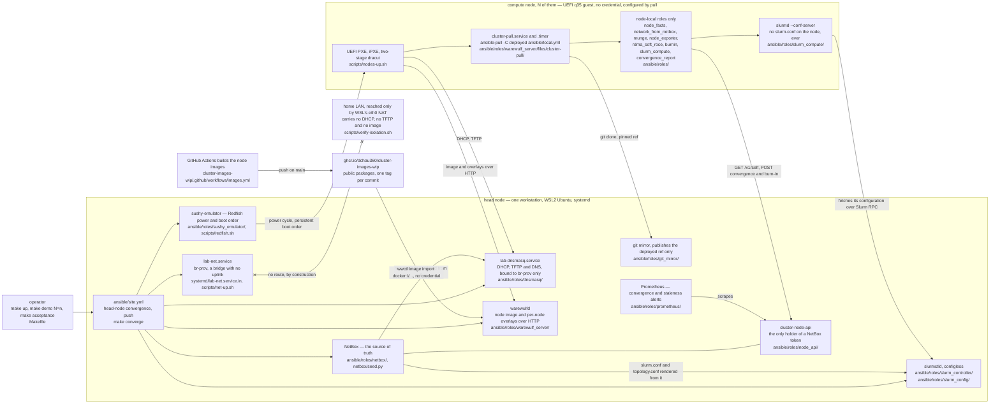

# cluster-platform-wip

A small HPC cluster built the way large ones are: machines PXE-boot a node
image over the network, NetBox is the source of truth, nodes configure
themselves with Ansible, and Slurm runs the work. It runs on one Windows
workstation (WSL2 plus KVM), with a head node and four compute nodes.

This README is the operator's manual. It covers the whole path, in order:

1. **[Build it from scratch](#part-1--build-it-from-scratch)**: a bare
   Windows machine to a running Slurm cluster.
2. **[Connect from your workstation](#part-2--connect-from-your-workstation)**:
   SSH to the head node and every node, plus the web UIs.
3. **[Use it](#part-3--use-it)**: run jobs, share files, install software,
   read accounting.
4. **[Run it day to day](#part-4--run-it-day-to-day)**: start and stop it, add
   nodes, change the node image, alerts, troubleshooting.

How it works, how to verify it, and the full documentation index are in
**[Reference](#reference)**, further down.

> This repository is **public**. Never commit an address, username or MAC from
> your own network, or any key. `lab/local.env` holds those values and is not
> tracked. See [Repository rules](#repository-rules).

## The cluster at a glance

```text
 your workstation (Mac/Linux)
      |  ssh
      v
 Windows host  -- OpenSSH server --  wsl -e nc 127.0.0.1 22
      |
      v
 head node = the WSL2 Ubuntu distribution ----------------------------------
 |  login + submit host     ssh cluster, sbatch, srun, sinfo, sacct         |
 |  Slurm                   slurmctld, slurmdbd + MariaDB (accounting)      |
 |  provisioning            dnsmasq (DHCP/TFTP), warewulfd (images)         |
 |  source of truth         NetBox            :8000  (loopback only)        |
 |  monitoring              Prometheus :9090, Alertmanager :9093            |
 |  shared storage          NFS: /home (rw), /opt/software (ro on nodes)    |
 |  config release          git mirror serving the `deployed` ref           |
 |  BMC emulation           sushy-emulator (Redfish power and boot order)   |
 ---------------------------------------------------------------------------
      |  br-prov: an isolated bridge, 10.44.0.0/22, no route to your LAN
      v
 cn01 ... cnNN               KVM guests, UEFI PXE boot, stateless Rocky 9,
                              slurmd, sshd (key only), node_exporter
```

The head node is the only way in. Compute nodes sit on an isolated segment
with no internet access, the same way a production cluster's compute fabric
does.

| Machine | Role | You reach it with |
| --- | --- | --- |
| Windows host | Runs WSL2 and the KVM guests | `ssh cluster-win` |
| Head node (WSL Ubuntu) | Login node, Slurm controller, every service | `ssh cluster` |
| `cn01` … `cnNN` | Compute nodes | `ssh cn01` (as root), or through Slurm |

---

## Part 1 — Build it from scratch

Allow about an hour, most of it package downloads. Do steps 1.1 to 1.3 once
per machine.

### 1.1 What you need

| | Minimum | The lab this was built on |
| --- | --- | --- |
| CPU | x86-64 with VT-x/AMD-V turned on in the BIOS | 10 cores |
| RAM | 16 GB (head node + 4 nodes × 2 GB) | 32 GB, WSL sees 15 GiB |
| Disk | 60 GB free | 951 GB free |
| OS | Windows 11 (nested virtualization in WSL2) | Windows 11 Home 25H2 |
| Distribution | Ubuntu in WSL2 | Ubuntu 26.04 LTS |

A native Ubuntu machine works too. Skip 1.2 and start at 1.3.

### 1.2 Windows host

Run these in an **elevated PowerShell**.

**Install WSL2 and Ubuntu**, then reboot when asked:

```powershell
wsl --install -d Ubuntu
```

**Configure the WSL VM.** Create `%USERPROFILE%\.wslconfig`:

```ini
[general]
instanceIdleTimeout=-1      # keep Ubuntu running when no terminal is open

[wsl2]
vmIdleTimeout=-1            # keep the WSL VM running too
nestedVirtualization=true   # KVM inside WSL; the nodes are KVM guests
```

**Both idle timeouts are required.** Without `instanceIdleTimeout=-1`, WSL
powers Ubuntu off about a minute after the last session closes, even with
`vmIdleTimeout=-1` set. It takes the head node and every compute node with
it. This was measured on the lab, not guessed.

**Turn on the OpenSSH server**, so you can manage the lab from another
machine:

```powershell
Get-WindowsCapability -Online -Name OpenSSH.Server* | Add-WindowsCapability -Online
Set-Service sshd -StartupType Automatic
Start-Service sshd
```

**Authorize your workstation's key.** If your Windows account is an
administrator, OpenSSH reads `C:\ProgramData\ssh\administrators_authorized_keys`
and **ignores** `~\.ssh\authorized_keys`. That is the most common reason a key
is refused:

```powershell
# paste the contents of your workstation's ~/.ssh/id_ed25519.pub
Add-Content C:\ProgramData\ssh\administrators_authorized_keys 'ssh-ed25519 AAAA... you@laptop'
icacls C:\ProgramData\ssh\administrators_authorized_keys /inheritance:r /grant 'Administrators:F' /grant 'SYSTEM:F'
```

For a non-administrator account, use `%USERPROFILE%\.ssh\authorized_keys`.

Apply the WSL settings with `wsl --shutdown`. The next `wsl` command starts
WSL again with them.

### 1.3 Inside WSL

Open Ubuntu (`wsl -d Ubuntu`) and work there from now on.

**Turn on systemd and passwordless sudo.** Every lab service is a systemd
unit, and the harness configures networking and libvirt unattended:

```sh
printf '[boot]\nsystemd=true\n' | sudo tee /etc/wsl.conf
echo "$USER ALL=(ALL) NOPASSWD:ALL" | sudo tee /etc/sudoers.d/90-cluster-lab
```

Then run `wsl --shutdown` from Windows and open Ubuntu again.
`systemctl is-system-running` should print `running` or `degraded`.

**Install the packages:**

```sh
sudo apt-get update
sudo apt-get install -y --no-install-recommends \
  libvirt-daemon-system libvirt-clients libvirt-daemon-driver-qemu \
  qemu-system-x86 qemu-utils ovmf swtpm swtpm-tools \
  bridge-utils iproute2 nftables dnsmasq dnsmasq-utils \
  docker.io ansible-core ansible-lint python3-libvirt python3-lxml \
  openssh-server netcat-openbsd git make jq curl yamllint shellcheck
```

**Get the host out of the cluster's way.** The stock dnsmasq and TFTP
services would take the ports the lab's own DHCP and TFTP need. libvirt's
default NAT network is a routed network, which the isolated segment must
never have:

```sh
sudo systemctl disable --now dnsmasq.service tftpd-hpa.service 2>/dev/null || true
sudo systemctl mask dnsmasq.service tftpd-hpa.service
sudo systemctl enable --now libvirtd.socket docker.service ssh.service
sudo virsh net-destroy default 2>/dev/null || true
sudo virsh net-autostart --disable default 2>/dev/null || true
sudo usermod -aG kvm,libvirt,docker "$USER"
```

Log out of WSL and back in, so the new groups apply. Then check:

```sh
ls -l /dev/kvm        # must exist; if not, recheck .wslconfig and the BIOS
```

[`docs/lab-host-setup.md`](docs/lab-host-setup.md) explains each of these
choices.

### 1.4 Get the code and configure it

```sh
mkdir -p ~/src && cd ~/src
git clone https://github.com/dchau360/cluster-platform-wip.git
cd cluster-platform-wip
cp lab/local.env.example lab/local.env
```

Edit `lab/local.env`. Four values are yours, and every other default works
as shipped:

| Variable | Set it to | Used for |
| --- | --- | --- |
| `LAB_HOST_SSH` | `user@address` of the Windows host, as your workstation sees it | `make ssh-config` |
| `LAB_LAN_CIDR` | your home network, for example a `/24` | proving the cluster cannot reach it |
| `LAB_LAN_PROBE_IP` | an address on that network that answers ping, usually the router | the same proof |
| `NODE_COUNT` | how many compute nodes to build, for example `4` | the default for `make demo` |

Node size is `NODE_VCPUS`, `NODE_MEM_MB` and `NODE_DISK_GB`. The file
documents every variable. `lab/local.env` is ignored by git, and CI fails if
one of its values ever shows up in a tracked file.

### 1.5 Bring the cluster up

```sh
make demo N=4
```

That one command, with no manual step in between:

1. **`make up`**: checks the host, installs the systemd units, and creates
   the isolated `br-prov` segment with its own DHCP and TFTP.
2. **`make converge`**: runs `ansible/site.yml` to build the head node. It
   starts NetBox and seeds it with N nodes, builds Warewulf, and imports the
   node image from GHCR. It sets up Slurm with accounting, NFS, Prometheus,
   Alertmanager and the git mirror.
3. **`make nodes-up`**: defines N UEFI virtual machines and powers them on
   over Redfish. Each PXE-boots, loads its image from Warewulf, and runs
   `ansible-pull` to configure itself.
4. **`make nodes-activate`**: each node runs burn-in (CPU, memory, disk), and
   a gate on the head node decides whether it becomes `active`.
5. **`make slurm-ready`**: waits for every node to register with Slurm, then
   runs a job array with one task on every node.

It ends with a table of how long each phase took on each node. The **first**
run takes longer than later ones, because it builds Warewulf from source and
downloads the NetBox containers and the node image. Later runs on this lab
take about five minutes.

### 1.6 Check it works

```sh
sinfo                       # every node idle in the `compute` partition
make status                 # units, segment, VMs, DHCP leases
make convergence-status     # each node's config commit, image tag, last run
make verify-isolation       # proves the segment cannot reach your LAN
```

Expected `sinfo`:

```text
PARTITION AVAIL  TIMELIMIT  NODES  STATE NODELIST
compute*     up   infinite      4   idle cn[01-04]
```

The cluster is ready. Everything from here on is how to use it.

---

## Part 2 — Connect from your workstation

All of this is done once, from the head node (inside WSL).

**Let your workstation's key in** to the head node, and as root to every
compute node:

```sh
cd ~/src/cluster-platform-wip
make authorize-key KEY='ssh-ed25519 AAAA... you@laptop'
```

**Get your SSH config:**

```sh
make -s ssh-config
```

Paste the printed block into `~/.ssh/config` **on your workstation**. It
defines four hosts:

| Host | What it is |
| --- | --- |
| `cluster-win` | the Windows host |
| `cluster` | the head node, reached through Windows with `wsl -e nc`. Nothing on Windows needs port forwarding, and a WSL address that changes on restart never appears anywhere |
| `cluster-tunnel` | the head node again, forwarding the web UIs to your `localhost` |
| `cn??` | every compute node, as root, jumping through the head node |

From your workstation:

```sh
ssh cluster                 # the head node
ssh cn01                    # root on a compute node
ssh -N cluster-tunnel       # leave running, then open the URLs below
```

| Service | URL (with the tunnel up) | Login |
| --- | --- | --- |
| NetBox: inventory, IPAM, each node's facts and burn-in | http://localhost:8000 | on the head node: `sudo grep -E '^SUPERUSER_(NAME\|PASSWORD)=' /etc/cluster-lab/netbox.env` |
| Prometheus: node and Slurm metrics, alert rules | http://localhost:9090 | none |
| Alertmanager: firing alerts, silences | http://localhost:9093 | none |

These services listen only on the head node's loopback. The tunnel is the
only way to reach them, and they are never exposed on your LAN.

---

## Part 3 — Use it

Log in to the head node (`ssh cluster`). It is the login node: you submit
work there and Slurm runs it on the compute nodes.

### Who you are

| Account | Where | Use it for |
| --- | --- | --- |
| your own login | head node | running `make` targets and admin commands with `sudo` |
| `hpc` | every machine, uid 2000, home on shared `/home` | running jobs. It is in the Slurm account, and can SSH between any two machines without a password, which is what MPI needs |
| `root` | compute nodes | looking around and debugging. Not for changing anything; see below |

Become the job user:

```sh
sudo -iu hpc
```

To add more job users, add them to `cluster_job_users` in
`ansible/group_vars/all.yml` and run `make converge`.

### Run jobs

```sh
sinfo                                   # partitions and node states
srun -N4 hostname                       # one task on each of 4 nodes
srun -w cn02 --pty bash                 # interactive shell on cn02, inside a job
salloc -N2                              # hold 2 nodes; srun inside uses them
```

A batch job. Save this as `~/hello.sbatch`:

```sh
#!/bin/bash
#SBATCH --job-name=hello
#SBATCH --nodes=4
#SBATCH --ntasks-per-node=1
#SBATCH --time=00:05:00
#SBATCH --output=%x-%j.out
srun hostname
```

```sh
sbatch ~/hello.sbatch       # prints the job id
squeue                      # pending and running jobs
cat hello-<jobid>.out       # output lands in your shared home
scancel <jobid>             # cancel
```

**An MPI job.** Open MPI is in the node image. It is not on your `PATH` by
default, which is normal on Rocky Linux, so load its module first:

```sh
#!/bin/bash
#SBATCH --job-name=mpi-hello
#SBATCH --nodes=4
#SBATCH --ntasks-per-node=2
#SBATCH --output=%x-%j.out
source /etc/profile.d/modules.sh
module load mpi/openmpi-x86_64
mpirun hostname
```

**Accounting.** Every job is recorded in `slurmdbd`:

```sh
sacct                                                   # your jobs today
sacct -a -S now-1day -X -o JobID,User,NodeList,Elapsed,State,ExitCode
sreport cluster utilization start=now-7days
```

### Files

| Path | Shared how | Put here |
| --- | --- | --- |
| `/home/<user>` | NFS from the head node, read-write everywhere | job scripts, input, output |
| `/opt/software` | NFS, read-write on the head node, **read-only** on nodes | software every node should see |
| `/tmp` and everything else on a node | local, **erased on reboot** | scratch only |

Copy data in from your workstation with `scp data.tar cluster:`, then move
it into the job user's home:

```sh
sudo install -o hpc -g hpc data.tar /home/hpc/
```

### Install software

Compute nodes are **stateless** and have **no internet**. `dnf install` on a
node has no repository to reach, and anything changed by hand is gone at the
next reboot. Software goes in one of two places:

**1. User software: `/opt/software` on the head node.** Every node mounts
it, so anything installed there is on every node at once. It is
group-writable by `hpc`.

One rule matters: **the head node is Ubuntu and the nodes are Rocky 9.** A
plain `python3 -m venv` made on the head node does not work on the nodes. It
points at the head node's Python 3.14, and the nodes have 3.9. Software in
`/opt/software` has to bring its own runtime, or be built for Rocky 9.

*Python and scientific stacks: use conda (micromamba).* Each environment
carries its own interpreter and libraries, so it runs the same on both
systems:

```sh
sudo -iu hpc
mkdir -p /opt/software/bin
curl -fsSL https://micro.mamba.pm/api/micromamba/linux-64/latest | tar -xj -C /opt/software bin/micromamba
export MAMBA_ROOT_PREFIX=/opt/software/conda
/opt/software/bin/micromamba create -y -p /opt/software/envs/sci -c conda-forge python=3.12 numpy
srun -N4 /opt/software/envs/sci/bin/python -c 'import numpy, socket; print(socket.gethostname(), numpy.__version__)'
```

*Compiled code: build it for Rocky 9 in a container on the head node.* The
output runs on the nodes unchanged:

```sh
sudo docker run --rm -v /opt/software:/opt/software rockylinux/rockylinux:9 bash -c '
  dnf -y install gcc make &&
  gcc -O2 -o /opt/software/bin/myprog /opt/software/src/myprog.c'
sudo -iu hpc srun -N4 /opt/software/bin/myprog
```

Use the same pattern for Spack or `make install` with
`--prefix=/opt/software/<name>`. Static binaries, such as most Go and Rust
release downloads, work as they are.

**2. System packages and drivers: the node image.** Add the package to
[`cluster-images-wip`](https://github.com/dchau360/cluster-images-wip), then
roll the new image out. See [Change the node image](#change-the-node-image).
This is the only kind of change that survives a reboot and is identical on
every node.

### Log in to a node directly

```sh
ssh cn01                # from your workstation, as root
sudo ssh cn01           # from the head node, as root
ssh cn01                # from the head node, as hpc
```

Use a login to look, not to change. Nodes configure themselves from git
every 15 minutes and at every boot, so a change made by hand is undone. Make
the change in an Ansible role and promote it (see
[Change node configuration](#change-node-configuration)).

---

## Part 4 — Run it day to day

Run everything here on the head node, in `~/src/cluster-platform-wip`.
`make help` lists every target.

### Start and stop

| You want to | Run |
| --- | --- |
| Bring everything up, or check it is all up (safe to repeat) | `make demo N=4` |
| Start only the platform, no nodes | `make up && make converge` |
| Start the nodes | `make nodes-up` |
| Stop the nodes, keep their disks | `make nodes-down` |
| Stop the nodes and the segment | `make down` |
| Stop everything and keep it off after a reboot | `make down-hard` |
| See what is running | `make status` |

**After a Windows reboot**, the head node's services come back by themselves:
they are systemd units enabled at boot. The compute nodes stay off until you
start them. Run `make demo N=4`: it skips everything already in place and
boots the nodes. To have WSL start at logon without anyone opening a
terminal, run this once in an elevated PowerShell:

```powershell
powershell -ExecutionPolicy Bypass -File \\wsl$\Ubuntu\home\<you>\src\cluster-platform-wip\scripts\windows\install-autostart.ps1
```

### Add, remove and rebuild nodes

| You want to | Run |
| --- | --- |
| Grow the lab, for example to 6 VMs | `make demo N=6`. To make a count the default, set `NODE_COUNT` in `lab/local.env` |
| Add a physical machine | Create it in NetBox (site `lab`, role `Compute`, its PXE NIC's real MAC as primary MAC), run `make converge`, then PXE-boot it. It discovers itself and arrives `staged`; `make nodes-activate` burns it in |
| Take a node out of service | `make drain NODES=cn03`, and `make resume NODES=cn03` to bring it back |
| Rebuild one node from bare metal; its neighbours keep running | `make drill-reprovision` |
| Power a node off, on, or cycle it | `bash scripts/redfish.sh power cn02 off\|on\|cycle` |
| Watch a node's console | `sudo virsh -c qemu:///system console cn02` (leave with `Ctrl+]`), or `$LAB_VM_DIR/console/cn02.log` |

Nothing is edited per node: NetBox is the input, and DHCP, Warewulf and
`slurm.conf` are rendered from it. See
[Add a machine](docs/operations.md#add-a-machine).

### Change the node image

Images are built by GitHub Actions in `cluster-images-wip` and published as
immutable `sha-<commit>` tags. They are never edited on the server.

```sh
# 1. in cluster-images-wip: add a line to images/compute-base/packages.txt,
#    open a PR, merge. The Actions run summary prints the new tag.
# 2. on the head node:
make rolling-update TAG=sha-<new>     # one node at a time: drain, reboot, check, resume
make rollback TAG=sha-<previous>      # if you need to go back
sudo wwctl image list                 # what is imported
```

A rolling update stops on the first node that fails its health check, and
puts that node back on the old image.

### Change node configuration

Node configuration is the Ansible in this repository. Nodes pull a pinned
`deployed` ref, never `main`, so a merge changes nothing until you release it.
Releasing pushes that ref to GitHub, and only after CI passed on the commit,
so it needs `gh auth login` on the head node with push rights to the repo:

```sh
git pull                              # after your PR is merged
make promote SHA=$(git rev-parse HEAD)   # nodes converge within 15 minutes, or at next boot
make convergence-status               # every node on the new commit?
make promote SHA=<previous>           # roll back
```

Head-node changes (Slurm controller, NetBox, Prometheus) apply with
`make converge`. `slurm.conf` is rendered from NetBox; after a NetBox change,
run `make reconfigure`.

### Alerts

Prometheus alerts on a node down, a stale or failed config pull, a failed
burn-in, `slurmctld` down, and a Slurm node unavailable. In the lab, alerts
go to the journal:

```sh
sudo journalctl -u cluster-alert-webhook -f
```

To page a real person, swap the `lab-webhook` receiver for PagerDuty or Slack.
There is a runbook per alert in
[`docs/operations.md`](docs/operations.md#alerting-and-runbooks).

### Troubleshooting

| Symptom | Check |
| --- | --- |
| `ssh cluster-win` says `Permission denied (publickey)` | Either Windows does not have your key (for an admin account it must be in `C:\ProgramData\ssh\administrators_authorized_keys`, see [1.2](#12-windows-host)), or your key has a passphrase and nothing can unlock it. `ssh -v cluster-win` shows `Server accepts key` followed by a denial in the second case. On macOS, run `ssh-add --apple-use-keychain ~/.ssh/id_ed25519` once and add `UseKeychain yes` to `~/.ssh/config` |
| `ssh cluster` says `Permission denied` but `ssh cluster-win` works | The head node does not have your key. `make authorize-key KEY='...'` on the head node ([Part 2](#part-2--connect-from-your-workstation)) |
| `ssh cn01` refused but `ssh cluster` works | Your key is not in root's keys yet. Run `make authorize-key` again; nodes pick up the change within about a minute |
| `ssh cluster` hangs or `nc` errors | WSL is stopped or starting. `ssh cluster-win wsl -d Ubuntu -e true` starts it |
| The whole cluster is off every time you come back | WSL is stopping when idle. Set both timeouts in `.wslconfig` ([1.2](#12-windows-host)), then `wsl --shutdown` |
| `sinfo` shows `unk*` or `down*` | The nodes are off. `make nodes-up`, or `make demo N=4` |
| A node stays `drain` | `sinfo -R` gives the reason. Fix it, then `make resume NODES=<node>` |
| `sudo ssh cn01`: `Connection refused` | The node has not finished its first config pull. `make convergence-status`; the console log is `$LAB_VM_DIR/console/cn01.log` |
| `ssh cn01`: `Connection reset by peer` or `Connection closed`, while other nodes work | The node's sshd is penalising the head node after failed logins (OpenSSH 9.8+). The `node_sshd` role exempts the head node; a node still on an older config clears itself within 10 minutes if you stop retrying. `sudo srun -w cn01 journalctl -u sshd -n 20` shows `penalty:` lines |
| `sudo ssh cn01`: `Could not resolve hostname` | `make converge` re-renders `/etc/hosts` from NetBox |
| A job is stuck pending | `squeue -l` gives the reason; `scontrol show job <id>` gives the detail |
| A node failed burn-in | NetBox: the device's `burnin_results` custom field. Then [BurnInFailed](docs/operations.md#burninfailed) |
| `make convergence-status` prints a JSON error | NetBox is still starting (it takes about a minute after a cold start). Retry |

More, including every endpoint and port, is in
[`docs/operations.md`](docs/operations.md).

---

## Reference

Background for operating and changing the cluster: how the pieces fit, how to
prove it still works, what it measured, and where it stops. `make help` lists
every target.

### How it works

Every box names the path in this repository (or in `cluster-images-wip`)
that builds it. The boot-path diagram and the
rest of the detail are in [`docs/architecture.md`](docs/architecture.md).



Read it as a sentence: the operator pushes to the **head node** only; the head
node serves images, addresses, facts and a pinned git ref onto an **isolated
segment**; each **node** pulls its own configuration from that segment and
reports back; and the only thing crossing in from the public internet is a
node image from a public registry, fetched with no credential.

### Verify it

Each row is a check you can run on the lab host after a change. The evidence
column is the result of the last recorded run.

| What it checks | Command | Evidence |
| --- | --- | --- |
| Powered-off to a cluster that takes work, no manual step | `make demo N=<n>` | `sinfo` idle, a job array with one task per node, all `COMPLETED 0:0` — [console output](docs/acceptance-drills.md#measured-results) |
| The same code at any node count | `make demo N=<a>` / `N=<b>` | per-phase tables at `N=1`, `2` and `4` — [the curve](docs/measurements.md#results) |
| Idempotent: a second run changes nothing | `make verify-idempotent` | head converge `ok=119 changed=0`, node pull `ok=38 changed=0`; the build fails otherwise |
| The provisioning segment cannot reach the home LAN | `make verify-isolation` | proven from inside the segment, in a namespace configured as a node — [design](docs/network-isolation.md) |
| A degraded node never joins the cluster | `make burnin-gate` | a disk throttled to 4 MiB/s against a 20 MiB/s floor was set `failed` — [drill](docs/acceptance-drills.md#the-burn-in-gate-holds-a-deliberately-failed-node) |
| A real RDMA bandwidth number, no IB hardware | `make rdma-test` | `ib_write_bw` 396.21 MB/s, `ib_send_bw` 480.11 MB/s over `rdma_rxe`; `iperf3` 64.3 Gbit/s on the same link |
| One node re-provisions while its neighbours keep running | `make drill-reprovision` | every neighbour's domain id unchanged and its QEMU CPU time still growing |
| Identity survives a NIC swap | `make drill-nic-swap` | hostname and NetBox device unchanged, MAC changed |
| Image rollback, and rollout that rolls itself back | `make rollback TAG=sha-<previous>` | the booted node reports the older tag; a rollout to a broken image stopped itself after one node |
| Configuration rollback in one ref move | `make promote SHA=<previous>` | **2.95 s measured**; every node converged on the commit the ref names |
| Cold-start recovery after the host restarts | `make cold-start-check` | every lab service is a systemd unit enabled at boot, and the drill proves the lab returns |
| No secret and no host value in git | `make lint` | `gitleaks` over the worktree and the full history, plus a host-value gate — [repository rules](#repository-rules) |

### Measured performance

Measured on the lab host on 2026-10-13, platform `5ab1a81`, node image
`sha-baa648ba99c8`. Full tables in [`docs/measurements.md`](docs/measurements.md#results).

| | N=1 | N=2 | N=4 | Grows with N? |
| --- | --- | --- | --- | --- |
| `platform-up` | 0.225 s | 0.211 s | 0.211 s | no |
| `converge` (head node) | 47.740 s | 47.415 s | 50.050 s | no |
| `nodes-up` (the boot loop) | 28.135 s | 29.342 s | 34.509 s | slightly |
| `nodes-activate` (burn-in, gate, promotion reboot) | 95.482 s | 126.176 s | 189.203 s | **yes, linear** |
| `slurm-ready` | 12.144 s | 12.150 s | 12.178 s | no |
| **wall clock** | **183.8 s** | **215.3 s** | **286.2 s** | |

The interesting result is not how long one node takes. It is **which phases
stay flat**: `converge` does not move, which is the check that no per-node work
leaked into a per-run step. The phase that bends is the image and overlay fetch
(`overlay`: 6.80 s at one node, 7.44 s at two, 11.24–11.87 s at four), and that
is the phase the scale argument is built on.

### Known limits

What this lab cannot show, because it is one workstation with no real
fabric and no real BMC.

- **No InfiniBand hardware, and never any.** The GUID discovery and the DHCP
  option-61 client-id reservations are real code, exercised only against
  synthetic GUID data. The RDMA numbers above are Soft-RoCE over Ethernet —
  a genuine verbs data path and an unreal fabric, with no subnet manager.
  See [`docs/ib-and-dhcp-option61.md`](docs/ib-and-dhcp-option61.md) and
  [`docs/rdma-soft-roce.md`](docs/rdma-soft-roce.md).
- **No real BMC.** `sushy-emulator` gives real power on/off/cycle and real
  persistent boot-order changes — the path OpenStack Ironic uses in its own
  CI. It does **not** give vendor BIOS attributes: the pending/applied two-step,
  `@Redfish.Settings` semantics, or attribute names that change spelling
  between firmware releases. See [`docs/redfish.md`](docs/redfish.md).
- **Nothing above four nodes.** One workstation fits a handful of guests. The
  DHCP and image-pull stampede at 100 nodes is **arithmetic over a measured
  per-node cost**, not an observation, and it is labelled that way wherever it
  appears. Where it breaks — starting with an address plan that fails at node
  81, not with throughput — is in
  [`docs/scale-analysis.md`](docs/scale-analysis.md).

The full gap list — what is **built**, what is designed and what has not
started, with the fix and the rough cost for each — is
[`docs/production-readiness.md`](docs/production-readiness.md).

### Documentation

For running the cluster:

- [`docs/operations.md`](docs/operations.md): every endpoint and port, adding
  or replacing a node, the day-2 plays, alerts and their runbooks.
- [`docs/acceptance-drills.md`](docs/acceptance-drills.md): every drill, with
  its console output. Run one when you want to prove a change did not break
  re-provisioning, rollback or the burn-in gate.
- [`docs/lab-host-setup.md`](docs/lab-host-setup.md): what the lab host needs,
  and why.

For understanding or changing it:

- [`docs/architecture.md`](docs/architecture.md): the diagrams, the boot path
  phase by phase, where configuration comes from, where state lives.
- [`docs/node-self-configuration.md`](docs/node-self-configuration.md): the
  pull design, and the four jobs the head node pushes.
- [`docs/network-isolation.md`](docs/network-isolation.md),
  [`docs/discovery.md`](docs/discovery.md),
  [`docs/redfish.md`](docs/redfish.md),
  [`docs/rdma-soft-roce.md`](docs/rdma-soft-roce.md),
  [`docs/ib-and-dhcp-option61.md`](docs/ib-and-dhcp-option61.md): one
  subsystem each.
- [`docs/tradeoffs.md`](docs/tradeoffs.md): the three design decisions, each
  with the option not taken.

For growing it:

- [`docs/measurements.md`](docs/measurements.md): the 1-to-N timing curve.
- [`docs/scale-analysis.md`](docs/scale-analysis.md): where it breaks at 100
  nodes, and the order to fix it in.
- [`docs/production-readiness.md`](docs/production-readiness.md): every gap
  between this lab and production, with its fix, effort and status.

### What is here

| Working now | Where |
| --- | --- |
| Isolated provisioning bridge, no route to the home LAN | `scripts/net-up.sh` |
| dnsmasq bound to that bridge only: DHCP, TFTP, the Warewulf PXE chain | `scripts/net-up.sh` |
| UEFI/OVMF nodes, created, re-provisioned and destroyed by the harness | `scripts/nodes-up.sh` |
| Warewulf image import from GHCR, node/profile definitions, identity overlays | `ansible/roles/warewulf_server/` |
| NetBox as source of truth; dnsmasq reservations rendered from it | `ansible/roles/netbox/`, `ansible/roles/dnsmasq/` |
| Discovery boot that registers itself in NetBox and claims its IPAM address | `scripts/discover.sh`, `cluster-images-wip` |
| Redfish power and boot order via `sushy-emulator` | `ansible/roles/sushy_emulator/`, `scripts/redfish.sh` |
| Nodes that configure themselves by `ansible-pull` from a pinned ref | `ansible/local.yml`, `ansible/roles/warewulf_server/tasks/pull_overlay.yml` |
| A node API that holds the only NetBox token and answers only about the caller | `ansible/roles/node_api/` |
| Burn-in gate, Slurm registration and a job array on every node | `scripts/nodes-activate.sh`, `scripts/slurm-ready.sh` |
| Configless Slurm rendered from NetBox, including `topology.conf` | `ansible/roles/slurm_config/` |
| Soft-RoCE RDMA: a real `perftest` number over `rdma_rxe`, no IB hardware | `scripts/rdma-test.sh`, `docs/rdma-soft-roce.md` |
| Rollback, rolling update, re-provision, NIC swap and cold-start drills | `Makefile`, `docs/acceptance-drills.md` |
| Convergence reporting, staleness detection and Prometheus alert rules | `ansible/roles/convergence_report/`, `ansible/roles/prometheus/` |
| Per-phase, per-node timing, NDJSON plus CSV | `scripts/lib/timing.sh` |
| Every lab service a systemd unit enabled at boot | `systemd/` |

### Structure

```text
Makefile                      up / down / demo N=<n>, and every gate
lab/
  local.env.example           every host-specific variable, named and documented
  local.env                   the real values. UNTRACKED. never commit this.
scripts/
  up.sh down.sh demo.sh       the harness entry points
  preflight.sh                tool, KVM, firmware and systemd checks
  net-up.sh net-down.sh       the isolated provisioning segment and dnsmasq
  nodes-up.sh nodes-down.sh   UEFI nodes on the segment
  nodes-activate.sh           burn-in, the gate, and the promotion reboot
  slurm-ready.sh              wait for every node to join, then run a job array
  promote.sh rollback.sh      the release step, and both rollbacks
  day2.sh                     drain, resume, reconfigure, rolling update, gate
  discover.sh redfish.sh      the discovery boot and the Redfish client
  drill-*.sh                  the acceptance drills
  systemd-install.sh          render and install the units
  status.sh                   units, segment, nodes, leases on one screen
  verify-isolation.sh         prove the segment cannot reach the home LAN
  verify-idempotent.sh        prove a second 'make up' changes nothing
  cold-start-check.sh         prove every unit is enabled at boot
  check-no-host-values.sh     the leak gate. also runs in CI.
  check-node-count-is-variable.sh
  lib/common.sh               config loading, change accounting, primitives
  lib/timing.sh               phase_begin / phase_end / timing_report
  lib/boot-phases.sh          live console watchers for the boot phases
systemd/
  lab.target.in               one handle for the whole lab
  lab-net.service.in          the segment, at boot
  lab-dnsmasq.service.in      DHCP, DNS and TFTP, on the segment only
ansible/
  site.yml                    head-node play, asserts the invariants
  local.yml                   the node's own play, run by ansible-pull
  group_vars/all.yml          node count and segment, as variables
  inventory/lab.yml           control host. compute nodes are generated.
  roles/                      dnsmasq, warewulf, netbox, slurm, node-local roles
  playbooks/day2/             drain, resume, rolling update, burn-in gate
netbox/
  definition.yml seed.py      the source of truth, and how it is seeded
  test_*.py                   unit tests for the renderers, API and gate
molecule/
  node_pull/                  the node play, converged in a container
docs/
  tradeoffs.md                the three decisions, both sides of each
  architecture.md             the diagrams, and how the pieces fit
  measurements.md             the 1-to-N curve
  scale-analysis.md           where it breaks at 100 nodes
  production-readiness.md     every gap between this lab and production
  acceptance-drills.md        every drill, with its output
  node-self-configuration.md  the pull design and the four pushed jobs
  network-isolation.md        the isolation design and how it is proven
  discovery.md                the discovery boot
  redfish.md                  what the management plane does and does not do
  rdma-soft-roce.md           the RDMA numbers, and what they are not
  ib-and-dhcp-option61.md     the InfiniBand code that has no hardware
  lab-host-setup.md           what the lab host needs, and why
  operations.md               status, NetBox inventory, add or replace a node
```

### Design decisions worth knowing

**The provisioning segment has no uplink.** `br-prov` is a Linux bridge
with no port except node taps. There is no path to the home LAN by
construction. Three further measures make that enforced rather than
habitual: IP forwarding off on the interface, an nftables table of our own
that drops anything forwarded into or out of the bridge, and dnsmasq bound
to the bridge address with `bind-interfaces`. `make verify-isolation`
proves it from inside the segment, using a network namespace configured the
way a node would be. See [`docs/network-isolation.md`](docs/network-isolation.md).

**Nodes pull; only four jobs are pushed.** Nothing configures a compute node
over SSH, and a node holds no credential. sshd runs, key-only, for an
operator's `sudo ssh cn01` from the head node and for nothing else. It configures itself with `ansible-pull` from a pinned
`deployed` ref. The head node runs the four jobs a node cannot do for itself:
the Slurm controller and its configuration, the day-2 plays, the burn-in gate,
and promotion of the `deployed` ref. Node configuration is therefore **O(1) in
node count** — no play loops over N hosts. See
[`docs/node-self-configuration.md`](docs/node-self-configuration.md) and
[`docs/tradeoffs.md`](docs/tradeoffs.md#3-pull-versus-push).

**A node grades nothing about itself.** A `staged` node runs burn-in and posts
raw measurements; any `passed` or `verdict` key it sends is dropped. The gate on
the head node recomputes pass or fail against floors held in this repository
and sets the status. Nothing a node can reach can write its own status or name.

**Reconcile, do not rebuild.** Every harness action reports `ok` when the
system is already correct and `changed` only when it had to act. `make up`
ends with `RESULT: changed=N`, and `make verify-idempotent` fails the build
if a second run changes anything.

**Cold start is a tested path.** A Windows reboot or `wsl --shutdown` stops
everything in the distribution. Every lab service is therefore a systemd
unit enabled at boot, and `make cold-start-check` asserts it.

**Timing is built in, not added later.** The measured 1-to-N curve is a
deliverable, so `phase_begin` / `phase_end` were written before the phases
existed. Later work records into the same NDJSON stream and the table grows
with it.

**Nothing knows the node count.** `N` is a variable everywhere. CI fails
on a literal `NODE_COUNT` assignment, a literal loop bound, or a hardcoded
node-name list.

### Repository rules

Non-negotiable. CI enforces all but the last.

1. **This repository is public.** Every commit is world-readable forever.
2. **No host-specific value in a tracked file.** Not an address on the home
   LAN, not an SSH username, not a real MAC. Those live in `lab/local.env`,
   which is untracked. The repository ships `lab/local.env.example` with
   every variable named and documented. Example MACs are synthetic, from
   the locally-administered range, so they can never identify real
   hardware. The `host-values` CI job fails if a value from `local.env`
   appears in a tracked file, if a non-allowlisted IPv4 literal appears
   anywhere, or if a globally-unique MAC appears anywhere.
3. **No secret in git.** The Munge key, SSH host keys and TLS material come
   from Warewulf per-node overlays at boot. The `gitleaks` job scans the
   working tree and the full history; GitHub secret-scanning push
   protection refuses a credential at `git push`.
4. **No lab state in git.** No qcow2, no TFTP tree, no NetBox dump, no
   `*.retry`. All of it lives under `LAB_STATE_DIR`, outside the repo.
5. **Nothing knows the node count.**
6. **Every phase is timed, per node, and recorded.**
7. **DHCP and TFTP never run on an interface that can reach the home LAN.**

Run the same gates CI runs before you push:

```sh
make lint          # host values, gitleaks, yamllint, ansible-lint, shellcheck
make verify        # isolation and idempotency, on the lab host
```

### Licence

MIT — see [LICENSE](LICENSE).
