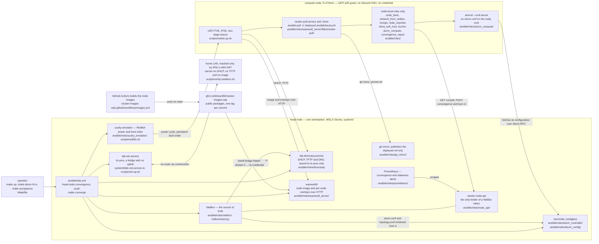
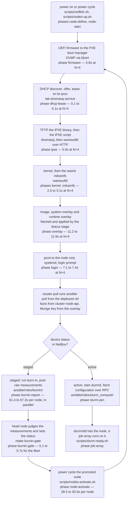

# Architecture

Every box below is a real path in this repository or in
[`cluster-images-wip`](https://github.com/dchau360/cluster-images-wip). If a
box has no path, it is not part of the system.

## The shape of it



Two networks, and they never meet. `eth0` is WSL's NAT interface; it
reaches the home LAN and carries no lab service. `br-prov` carries every
lab service and reaches nothing. `make verify-isolation` proves it from
inside the segment, from a network namespace configured the way a node would
be. See [`network-isolation.md`](network-isolation.md).

Three edges in that diagram are the whole design, and each is argued
elsewhere:

* **GHCR to warewulfd carries no credential.** The packages are public on
  purpose, because a provisioning host that needs a registry token is a
  provisioning host that cannot be rebuilt from nothing. The secret boundary
  that makes a public image safe is in `cluster-images-wip`'s
  [`docs/overlays.md`](https://github.com/dchau360/cluster-images-wip/blob/main/docs/overlays.md).
* **The node pulls; the platform pushes only what a node cannot do for
  itself.** Four jobs stay on the head node. See
  [`node-self-configuration.md`](node-self-configuration.md) and
  [`tradeoffs.md`](tradeoffs.md#3-pull-versus-push).
* **Nothing on a node holds a credential.** `cluster-node-api` holds the one
  NetBox token and offers a node three calls, all about itself, none of which
  can write a status or a name.

## Boot path for one node



Every node boots **twice** in a `make demo`, and that is not waste. The first
boot arrives `staged`, which means burn-in: nobody can log in to a node to
start `slurmd`, and a node that has not been judged must not join the
cluster. The gate on the head node recomputes pass or fail from the raw
numbers, sets the device `active`, and the promotion power-cycle is what puts
`slurmd` up on the second boot. The durations above are the per-node figures
measured at `N=4` on 2026-10-13; the full tables at `N=1`, `2` and `4` are in
[`measurements.md`](measurements.md#results).

Two things about the Warewulf half are worth recording because they are
configuration, not code, and both cost time to find:

* The server is built from source with the default prefix, so `wwctl` reads
  `/usr/local/etc/warewulf/warewulf.conf` and writes state under
  `/var/local/warewulf`. The packaged paths (`/etc/warewulf`,
  `/var/lib/warewulf`) are not used.
* The Ubuntu `ipxe` package has no `imgextract` command, which is a
  Warewulf patch. The node tag therefore selects the two-stage `dracut`
  method, and the node image must ship an initramfs built with the
  `wwinit` dracut module. `cluster-images-wip` builds that in; without it
  the node stops at `Failed to mount /sysroot`.

Each phase is a `phase_begin` / `phase_end` pair, per node, written to
NDJSON by `scripts/lib/timing.sh` and `scripts/lib/boot-phases.sh`. The
instrumentation was written before most of the phases existed, which is why
the 1-to-N curve exists at all — see
[`measurements.md`](measurements.md#how-the-boot-phases-are-measured).

## Discovery

An image that has no identity yet can boot a second image whose only job is
to describe it. `make discover` switches a node to the `discovery` image and
appends the `cluster-discovery` runtime overlay for one boot; the payload
scrapes DMI, CPU, memory, NICs, disks and GPUs and writes its own NetBox
device, interfaces and IPAM address. The NetBox endpoint and token arrive in
the overlay at boot, never in an image or in git. See
[`discovery.md`](discovery.md).

Those discovered facts are not decoration: `CPUs`, `RealMemory` and
`Gres=gpu:N` in the rendered `slurm.conf` come from the fields the discovery
boot wrote. A device NetBox does not fully describe is an error that names
the device and the field, never a default.

## The management plane

Power and boot order are driven over Redfish by `sushy-emulator` on the
libvirt/KVM driver, the path OpenStack Ironic uses in its own CI. It binds
to the provisioning address only, and `scripts/redfish.sh` is the client
the node power/boot automation calls:

```text
redfish.sh  --Redfish/HTTP-->  sushy-emulator (10.42.0.1:8000)  --libvirt-->  qemu/kvm
```

Real power on/off/cycle and real persistent boot-order changes. **Not**
vendor BIOS attributes: the emulator reports a fixed synthetic set. See
[`redfish.md`](redfish.md) for the capability table; the line between the
two is written down on purpose.

## Where configuration comes from

One path, no exceptions.

```text
lab/local.env.example   defaults. tracked. host values blank.
        |
        v  overridden by
lab/local.env           real values. UNTRACKED.
        |
        v  loaded by
scripts/lib/common.sh   lab_load_env()
        |
        +--> harness scripts
        +--> systemd units       (rendered from systemd/*.in)
        +--> dnsmasq config      (generated into LAB_STATE_DIR)
        +--> Ansible             (group_vars/all.yml reads the environment)
```

Nothing reads a host value any other way. That is what makes the CI leak
gate meaningful: there is exactly one place for a host value to be, so a
value anywhere else is a bug by definition.

## Where state lives

Everything mutable is under `LAB_STATE_DIR`, outside the repository:

```text
$LAB_STATE_DIR/
  dnsmasq/lab.conf        generated config
  dnsmasq/hosts           generated static reservations, synthetic MACs
  dnsmasq/leases          live leases
  dnsmasq/dnsmasq.log     DHCP and TFTP log
  tftp/                   boot tree
  timings/<run>.ndjson    per-phase, per-node records
  timings/<run>.csv       the same, for the curve
  run/                    pid and change-counter files
  xml/<node>.xml          rendered libvirt domains

$LAB_VM_DIR/
  <node>.qcow2            node disk
  nvram/<node>.fd         per-VM UEFI variables
  console/<node>.log      serial console
```

Warewulf keeps its own tree, because `wwctl` owns it and not the `make`
harness. It is outside both repositories, and the Munge key inside it is
the one piece of state that must never be copied into either:

```text
$WAREWULF_STATE_ROOT/            /var/local/warewulf
  chroots/<image>/               imported node image (kernel, initramfs with wwinit)
  overlays/<name>/rootfs/        site overlays; cluster-identity holds the Munge key
  provision/images/              built squashfs served to nodes
  provision/overlays/<node>/     per-node runtime and system overlay images
  tftpboot/warewulf/             iPXE binaries served by dnsmasq

/etc/cluster-lab/
  munge.key                      generated once, 0400 root, untracked
  netbox.env                     NetBox runtime secrets, 0600 root
```

None of it is in git, and `.gitignore` covers the shapes anyway, so an
accidental copy into the working tree is still not committable.

## Why a change counter

A provisioning harness that is not idempotent is a harness that cannot be
trusted to recover. Rather than asserting idempotency in prose, every
action in `scripts/lib/common.sh` reports `ok` or `changed`, `make up`
prints `RESULT: changed=N`, and `make verify-idempotent` fails if a second
run changes anything. It is cheap, and it catches the class of bug where a
step rewrites a file with a timestamp in it and quietly restarts a service
on every run.

Measured: a second `make converge` on a settled head node reports
`ok=119 changed=0`, and a second node-side pull run reports
`ok=38 changed=0 failed=0`
([`node-self-configuration.md`](node-self-configuration.md#evidence)).
